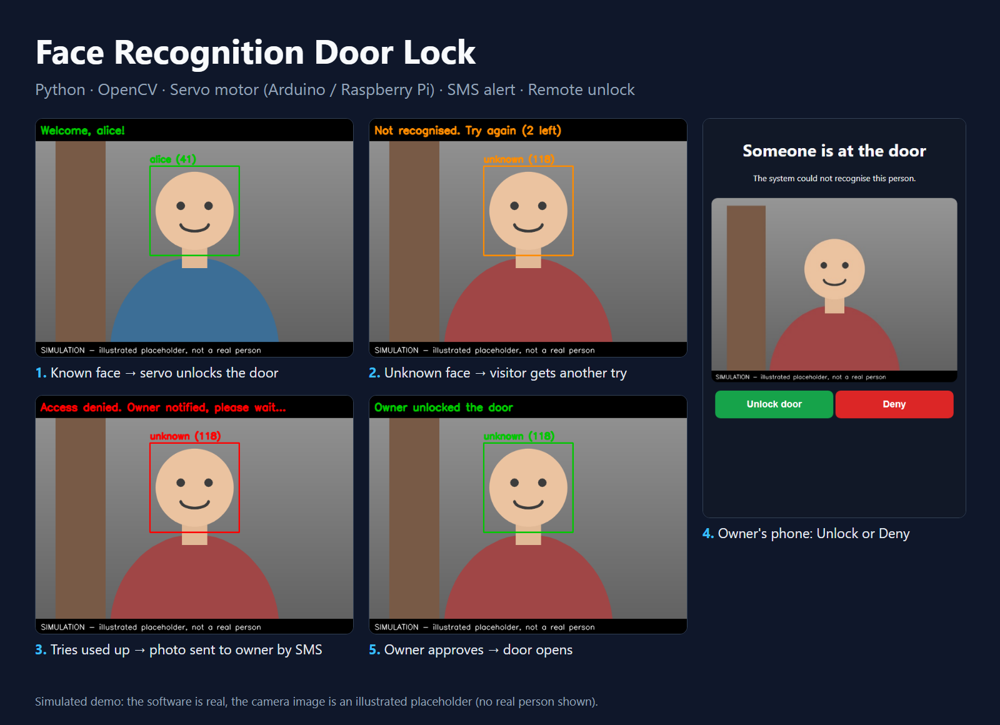
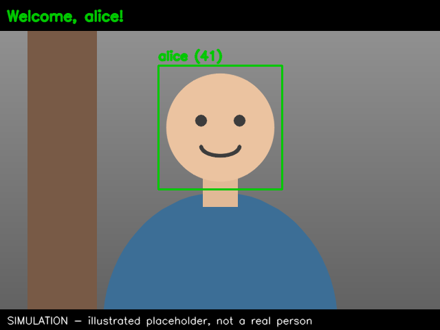
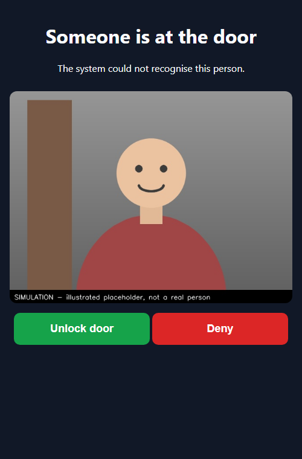
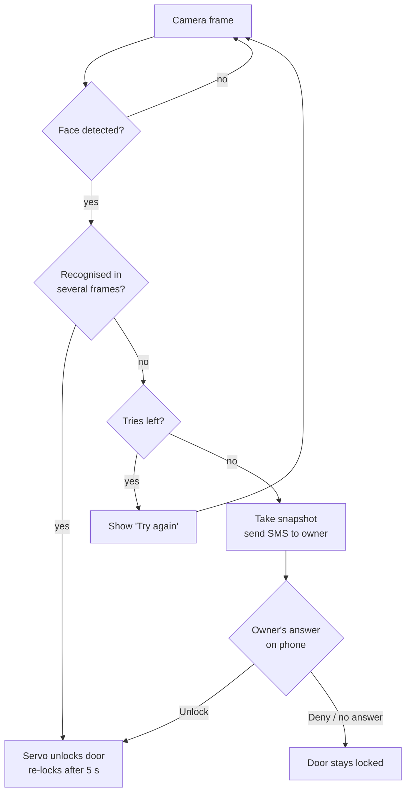

# Face Recognition Door Lock

A smart door lock that opens when it recognises your face. A camera scans the
visitor, OpenCV compares the face with the people in the database, and a servo
motor moves the latch. If the visitor is not recognised after a few tries, the
owner gets an **SMS with the visitor's photo** and can **unlock the door
remotely from their phone**.

Built with **Python, OpenCV, Flask, Twilio** and an **Arduino or Raspberry Pi** driving a servo motor.

## Demo (simulation)



> **Note:** these screenshots are a **simulation**. They are produced by the
> project's real access logic, on-screen overlay and owner web page, but the
> camera image is an illustrated placeholder and the recognition results are
> scripted, so no real person's photo is shared. Regenerate them with
> `python demo/make_screenshots.py`.

| Access granted | Owner's phone page |
|---|---|
|  |  |

## Features

- **Face recognition access** – Haar cascade face detection + LBPH recognition (OpenCV).
- **Servo-driven latch** – works with an Arduino (USB serial) or directly from Raspberry Pi GPIO.
- **Retry policy** – an unrecognised visitor gets several tries before anything else happens.
- **SMS alert with photo** – after the last failed try, the owner receives a text message with a link to the visitor's snapshot.
- **Remote unlock** – the link opens a mobile page with **Unlock** and **Deny** buttons.
- **Safe by default** – several consecutive matching frames are required, the door re-locks automatically, links are single-use, expire, and use unguessable tokens.
- **Event log** – every grant, failed try, alert and owner decision is written to `logs/events.csv`.
- **Runs without hardware** – a simulated lock and a console notifier let you try the full flow on a laptop with a webcam.

## How it works



## Hardware

| Part | Notes |
|---|---|
| Camera | USB webcam or Raspberry Pi camera |
| Servo motor | SG90 / MG996R, moves the latch |
| Controller | Arduino Uno/Nano (via USB) **or** Raspberry Pi GPIO |
| 2 LEDs + 220 Ω resistors | optional: green = open, red = locked |
| 5 V supply | external supply recommended for larger servos |

### Wiring (Arduino)

| Servo / LED | Arduino pin |
|---|---|
| Servo signal (orange) | D9 |
| Servo VCC (red) | 5V |
| Servo GND (brown) | GND |
| Green LED (+ resistor) | D6 |
| Red LED (+ resistor) | D7 |

Upload [arduino/door_lock/door_lock.ino](arduino/door_lock/door_lock.ino) with the Arduino IDE.

### Wiring (Raspberry Pi)

Servo signal → GPIO 18, VCC → 5 V, GND → GND. Set `LOCK_BACKEND=raspberrypi` and `pip install gpiozero`.

## Installation

```bash
git clone https://github.com/eskandersnoussi/face-recognition-door-lock.git
cd face-recognition-door-lock
python -m venv venv
venv\Scripts\activate          # Linux/macOS: source venv/bin/activate
pip install -r requirements.txt
copy .env.example .env         # Linux/macOS: cp .env.example .env
```

## Usage

**1. Enrol each authorised person** (captures 50 face samples from the camera):

```bash
python enroll.py --name alice
```

**2. Train the recogniser:**

```bash
python train.py
```

**3. Run the door lock:**

```bash
python main.py
```

Use `python main.py --headless` on a device without a screen.

With the default settings (`LOCK_BACKEND=simulated`, `NOTIFIER=console`) the lock
actions and the owner's link are printed in the terminal, so you can test
everything with only a webcam.

## Configuration

All settings live in `.env` (see [.env.example](.env.example)).

| Setting | Default | Meaning |
|---|---|---|
| `MATCH_THRESHOLD` | 65 | LBPH distance limit; lower = stricter |
| `REQUIRED_MATCHES` | 5 | consecutive matching frames needed to unlock |
| `MAX_ATTEMPTS` | 3 | failed tries before the owner is alerted |
| `ATTEMPT_SECONDS` | 4 | length of one try |
| `UNLOCK_SECONDS` | 5 | how long the door stays open |
| `OWNER_TIMEOUT` | 120 | seconds the owner has to answer |
| `LOCK_BACKEND` | simulated | `simulated`, `arduino` or `raspberrypi` |
| `SERIAL_PORT` | COM3 | Arduino port (`/dev/ttyACM0` on Linux) |
| `NOTIFIER` | console | `console` or `twilio` |
| `PUBLIC_BASE_URL` | *(empty)* | public address of the approval page |

### SMS alerts (Twilio)

1. Create a [Twilio](https://www.twilio.com/) account and get a phone number.
2. In `.env` set `NOTIFIER=twilio`, `TWILIO_ACCOUNT_SID`, `TWILIO_AUTH_TOKEN`,
   `TWILIO_FROM` (your Twilio number) and `OWNER_PHONE` (your mobile, e.g. `+15551234567`).

### Unlocking from anywhere

By default the link in the SMS points to the computer's local Wi-Fi address, so
the phone must be on the same network. To answer from anywhere, expose the port
with a tunnel and put its address in `.env`:

```bash
ngrok http 5000
```

```
PUBLIC_BASE_URL=https://your-tunnel.ngrok-free.app
SEND_MMS=true     # optional: photo attached inside the message (US/Canada numbers)
```

## Project structure

```
├── main.py                 # run the door lock
├── enroll.py               # capture face samples for a person
├── train.py                # train the LBPH model
├── doorlock/
│   ├── config.py           # settings from .env
│   ├── recognizer.py       # face detection + recognition (OpenCV)
│   ├── controller.py       # access state machine (tries, alert, unlock)
│   ├── lock.py             # servo backends: simulated / Arduino / Raspberry Pi
│   ├── notifier.py         # SMS alert (Twilio) or console
│   ├── access_requests.py  # pending owner approvals (tokens, expiry)
│   ├── server.py           # Flask page with Unlock / Deny buttons
│   └── overlay.py          # status text and face box on the preview
├── arduino/door_lock/      # Arduino servo sketch
├── demo/make_screenshots.py  # generates the simulated demo screenshots
├── tests/                  # unit tests (no camera or hardware needed)
└── docs/REPORT.md          # project report
```

## Tests

```bash
pytest
```

The tests cover the access logic (unlock, retries, owner alert, approval,
denial, expiry) and the approval web page, using a simulated lock.

## Limitations

- LBPH recognition is sensitive to lighting and pose, and a 2D camera cannot
  tell a real face from a printed photo. This is a learning / prototype
  project, not a certified security product.
- Possible improvements: liveness detection (blink check), a deep-learning
  face embedding model, a keypad/RFID fallback, and a login for the owner's page.

## License

MIT – see [LICENSE](LICENSE).
